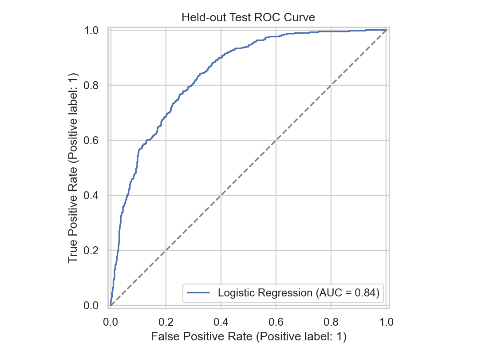

# Customer Churn Prediction and Retention Analysis

[](https://www.python.org/)
[](https://scikit-learn.org/)
[](LICENSE)

An end-to-end machine-learning portfolio project using the public IBM Telco
Customer Churn sample: **7,043 customers**, exploratory analysis, leakage-safe
preprocessing, model comparison, held-out evaluation, individual risk scoring,
and an interactive Streamlit dashboard.

> The exact results below are generated by the checked-in code with random seed 42.
> Run the notebook or training command to reproduce them.

## Project highlights

- Audits and cleans 21 source columns, including 11 blank `TotalCharges` values.
- Keeps imputation, scaling, and one-hot encoding inside scikit-learn pipelines.
- Selects the final model using stratified 5-fold cross-validation on training data only.
- Reports ROC-AUC, accuracy, precision, recall, classification report, ROC curve,
  and confusion matrix on an untouched 20% test set.
- Exports prioritized customer risk scores and a reusable fitted pipeline.
- Provides a Streamlit dashboard for single-customer scoring.

## Verified result

After running `python -m src.churn_pipeline`, the exact metrics are saved in
[`artifacts/metrics.json`](artifacts/metrics.json). This section should only be
updated from that file; do not invent or round up performance claims.

| Held-out metric | Result |
|---|---:|
| ROC-AUC | **0.841** |
| Accuracy | 0.738 |
| Precision | 0.504 |
| Recall | 0.783 |

The 0.50 threshold favors recall because missing a likely churner is assumed to
cost more than reviewing an additional customer. The ranking metric (ROC-AUC) is
threshold-independent.



## Repository structure

```text
.
├── app.py                         # Interactive Streamlit risk dashboard
├── artifacts/                     # Model, metrics, comparison, and risk scores
├── data/raw/                      # IBM sample CSV
├── docs/data_dictionary.md        # Field definitions
├── images/                        # Generated evaluation charts
├── notebooks/
│   └── customer_churn_analysis.ipynb
├── scripts/build_notebook.py      # Rebuilds the notebook source
├── src/churn_pipeline.py          # Reusable training pipeline
├── tests/test_pipeline.py         # Dataset/pipeline contract test
├── requirements.txt
└── LICENSE
```

## Run locally

```bash
python -m venv .venv
# Windows: .venv\Scripts\activate
# macOS/Linux: source .venv/bin/activate
pip install -r requirements.txt
python -m src.churn_pipeline
jupyter notebook notebooks/customer_churn_analysis.ipynb
streamlit run app.py
```

## Run on Kaggle

1. Create a new Kaggle Notebook.
2. Click **Add Input** and add the **Telco Customer Churn** dataset containing
   `WA_Fn-UseC_-Telco-Customer-Churn.csv`.
3. Upload or import `notebooks/customer_churn_analysis.ipynb`.
4. Choose **Save Version → Save & Run All**. A clean top-to-bottom run is the
   reproducibility check; Kaggle stores the version and generated outputs.
5. Make the notebook public and add its URL to this README and your résumé.

The notebook automatically searches Kaggle's `/kaggle/input` directories, so no
hard-coded account-specific dataset path is required.

## Put the project on GitHub

Create an empty GitHub repository (do not add a README there), then run:

```bash
git add .
git commit -m "Build reproducible customer churn prediction project"
git branch -M main
git remote add origin https://github.com/YOUR_USERNAME/customer-churn-prediction.git
git push -u origin main
```

Kaggle and GitHub do not need to remain automatically synchronized. Use Kaggle
to execute and publish the notebook; use GitHub as the complete source repository.
After changes in Kaggle, download the latest `.ipynb`, replace the file in
`notebooks/`, then commit and push it to GitHub.

## Résumé wording supported by this repository

> Built a reproducible customer churn prediction pipeline on 7,043 telecom
> customer records using Python and scikit-learn; performed EDA and feature
> engineering, compared classifiers with stratified cross-validation, and achieved
> a held-out ROC-AUC of **0.841**. Developed
> a Streamlit dashboard for customer risk scoring and retention prioritization.

Avoid saying the dashboard is “deployed” unless it has a public working URL.

## Data source and limitations

The project uses IBM's public Telco Customer Churn sample, a fictional telecom
dataset with 7,043 rows. The source CSV is retained for reproducibility and is
attributed to IBM. See [`docs/data_dictionary.md`](docs/data_dictionary.md).

This model is an educational portfolio demonstration, not a production decision
system. It should not be used for automated customer treatment without fairness,
drift, privacy, calibration, and causal-impact reviews.

## License

Project code is available under the [MIT License](LICENSE). The source dataset
remains subject to its original provider's terms.

